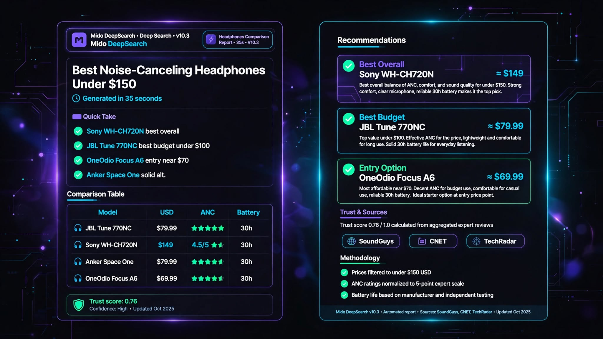
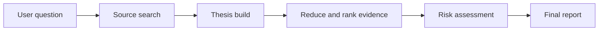

# Mido Deep Search

> **Do not collect dozens of links. Build a decision you can defend.**
>
> Mido Deep Search turns an ordinary question into a structured, source-backed report with clear comparisons, visible risks, and prices shown exactly as found in the source—without invented estimates.

<p align="center">
  <a href="https://midoaistore.github.io/mido-landing/"><strong>Try the live demo</strong></a> ·
  <a href="https://midoaistore.gumroad.com/l/dtqpvka"><strong>Get full access — $19</strong></a> ·
  <a href="https://github.com/midoaistore/mido-landing/issues">Report an issue</a>
</p>

<p align="center">
  <a href="https://github.com/midoaistore/mido-landing/stargazers">
    
  </a>
  
</p>



## Why Mido?

Search engines give you pages. AI tools give you answers. Mido is designed to give you a **reviewable path from question to decision**.

Try a request like this:

> Find the best programming laptop under $1,500. I want a real comparison with sources, current prices, and purchase risks.

Mido searches live sources, organizes the evidence, compares alternatives, separates verified information from missing evidence, and produces a report you can copy, save, download, share, or print as a PDF.

> **The goal is not to make the report sound confident. The goal is to show you why the conclusion was reached.**

## Start in under a minute

1. Open the [live demo](https://midoaistore.github.io/mido-landing/).
2. Choose your language and research skill.
3. Write a specific question with your budget, country, or comparison criteria.
4. Click **Search**.
5. Review the sources and report, then copy, download, save, or share it.

### Try one of these prompts

```text
Best wireless noise-cancelling headphones under $150, using reliable sources only.
Compare the MacBook Air and MacBook Pro for programming, including the limitations that could make the recommendation unsuitable.
Is the current price of this product verified? Show the currency, date, and source. Do not convert it to another currency.
A five-stage research pipeline

Mido does not rely on a decorative timer alone. The interface visualizes the workflow through five protection rings and the interactive bacterium-lite.html engine.



Stage What it does
1 — Source Search Retrieves live Tavily results and builds the initial evidence set.
2 — Thesis Build Identifies what must be verified before the report is written.
3 — Reduce and Rank Organizes options and evidence around the user’s criteria.
4 — Risk Assessment Exposes limitations, conflicts, missing data, and failure conditions.
5 — Final Report Produces structured findings with citations, sources, and uncertainty notes.

While the search is running, the biological visualizer reacts to the stages: completed balls remain illuminated, the current ball is emphasized, and the light moves progressively through all fifteen organelles.

15 skills — one report, multiple perspectives

You can begin with deep research and then reuse the same report and sources to apply another skill instead of starting a completely new search.

ID Purpose
deep_search Run a complete evidence-based research report.
summarize Compress the evidence while preserving the important points.
compare Compare valid options in a structured format.
recommend Rank alternatives and provide a transparent recommendation.
price_check Audit price, currency, date, and availability.
save Produce a clean report suitable for saving.
fact_check Classify claims as supported, contradicted, or unverified.
pros_cons Present a balanced analysis of strengths and weaknesses.
buying_guide Build a practical guide from criteria to final choice.
local_price_check Focus on local availability and locally sourced prices.
source_audit Evaluate source quality, relevance, recency, and independence.
risk_check Record risks, limitations, and failure conditions.
extract_facts Extract verifiable facts and label unsupported information.
outline Create a clear outline for the topic and report.
decision_matrix Build a decision matrix with criteria and transparent reasoning.

A skill is not just a label. Each skill changes the report objective and output structure.

Token-efficient skill reuse

Applying multiple skills to the same report does not trigger a new Tavily search and does not consume additional daily quota. Two layers of protection work together:

Client-side cache (frontend)

· First use of a skill calls the Worker and stores the result in transformCache[skill].
· Repeating the same skill returns the cached result instantly — 0 API calls.
· Selecting deep_search restores the original report from memory — 0 API calls.
· A new search resets the cache automatically.

Server-side transform mode (Worker)

· Transform requests (mode: "transform") reuse the base report and its sources.
· Transform calls are exempt from the rate limit — only full searches consume daily quota.
· Rate-limit counters therefore reflect actual research activity, not presentation toggles.

Practical result: a user can explore all 15 skills on one report while consuming only one search from the daily quota.

Evidence before eloquence

Mido is designed to say “unverified” when the evidence is insufficient instead of filling the gap with a confident-sounding guess.

· No invented prices, specifications, or availability.
· Prices remain in the currency used by the source unless an explicit conversion policy is enabled.
· Unsupported claims are labeled clearly.
· Product categories are not forced onto unrelated questions.
· Sources and citations are checked before they are shown to the user.
· Tavily and Groq keys never belong in the browser or inside the HTML source.
· Report language follows the query language, not the UI language — an English query produces an English report even on an Arabic interface.

Current capabilities

· Multilingual RTL and LTR interface (Arabic, English, French, German, Japanese, Chinese, Spanish, Portuguese).
· Five visual research stages with an interactive biological engine.
· Fifteen stable research skill IDs shared by the frontend and Worker.
· Structured sources and inline report citations.
· Copy, download, save, share, and print actions.
· Local report library for returning to previous reports.
· Browser printing with Save as PDF support.
· Word-compatible export generated locally in the browser.
· Privacy, usage, and safety policies built into the page.
· Gumroad license verification and Cloudflare KV caching and counters.
· Personal quota endpoint (POST /me) for accurate remaining-quota display.
· Admin session validation before credentials are stored in sessionStorage.

Technical architecture

```text
Browser
├── index.html
│   ├── Search interface and translations
│   ├── Skills and report rendering
│   ├── Client-side transform cache
│   ├── Local report library
│   └── Search-stage synchronization
│
├── bacterium-lite.html
│   └── Three.js visual engine with fifteen organelles
│
└── Cloudflare Worker
    ├── POST /                 Search and transform report generation
    ├── GET  /stats            Site-wide daily statistics
    ├── POST /visit            Global visitor counter
    ├── POST /me               Personal quota check (read-only)
    ├── Tavily                 Live web sources
    ├── Groq                   Planning, report generation, transformation, and fallback
    ├── Gumroad                License verification
    └── Cloudflare KV          License cache, rate limits, and usage counters
```

Repository layout

```text
index.html                 Static frontend
bacterium-lite.html        Interactive biological visualizer
worker.js                  Cloudflare Worker API
wrangler.toml              Worker deployment configuration
SETUP.md                   Setup and deployment guide
SKILL.md                   Reusable skill definition
WORKER_API_CONTRACT.md     Complete Worker API contract (v2.0)
CHANGELOG.md               Version history and change log
CONTRIBUTING.md            Contribution guidelines
SECURITY.md                Private vulnerability reporting
LICENSE                    Source Available license (non-commercial)
report-preview-en-hud.png  Report preview image
```

Pricing

Mido Deep Search is a one-time purchase available through Gumroad:

· Price: $19 (USD), one-time
· Includes: full access to Deep Search, setup guide, and 1 free trial before purchase
· Also required: your own Tavily and Groq API keys (created via the setup guide)
· No subscription and no recurring fees from Mido AI Store

For enterprise or commercial licensing inquiries: support@midoaistore.com

Run the frontend locally

Start a simple static server from the repository root:

```bash
python3 -m http.server 8080
```

Then open:

```text
http://localhost:8080
```

Do not open index.html directly through file:// when testing the iframe and network requests. Some browsers block these operations for security reasons.

Configure the Cloudflare Worker

Requirements

· A Cloudflare account.
· A current Wrangler installation.
· A Worker connected to a KV namespace.
· A Tavily account.
· A Groq account.
· Gumroad product details if license verification is enabled.

Install Wrangler and authenticate

```bash
npm install
npx wrangler login
```

Configure secrets

Never put provider keys in index.html, wrangler.toml, or GitHub. Add them as Cloudflare Worker Secrets:

```bash
npx wrangler secret put TAVILY_API_KEY
npx wrangler secret put GROQ_API_KEY
npx wrangler secret put ADMIN_KEY
```

Public configuration such as the Gumroad URL and Worker settings may be placed in wrangler.toml. Provider keys and the admin key must remain secrets.

Deploy

Run this from the repository root:

```bash
npx wrangler deploy
```

After deployment, update WORKER_URL in index.html if the Worker address has changed.

Request and response contract

See WORKER_API_CONTRACT.md for the complete contract. The summary below covers the essentials.

Search request

```http
POST /
Content-Type: application/json
Origin: https://midoaistore.github.io
```

```json
{
  "query": "Best programming laptop under 1500 USD",
  "visitor_id": "v_example",
  "skill": "deep_search",
  "country": "US",
  "lang": "en"
}
```

Transform request (skill reuse on existing report)

```http
POST /
Content-Type: application/json
```

```json
{
  "mode": "transform",
  "query": "Best programming laptop under 1500 USD",
  "base_answer": "<existing report markdown>",
  "base_sources": [
    { "title": "...", "url": "...", "snippet": "..." }
  ],
  "visitor_id": "v_example",
  "skill": "compare",
  "country": "US",
  "lang": "en"
}
```

Transform mode does not consume daily quota.

Personal quota check

```http
POST /me
Content-Type: application/json
```

```json
{ "visitor_id": "v_example" }
```

Response:

```json
{
  "ok": true,
  "user_type": "free",
  "remaining": 87,
  "limit": 100,
  "used": 13,
  "is_admin": false
}
```

Short successful search response

```json
{
  "ok": true,
  "report_id": "example-id",
  "answer": "...",
  "sources": [],
  "logs": [],
  "meta": {
    "skill": "deep_search",
    "sources_count": 0,
    "elapsed_ms": 0,
    "remaining_quota": 99,
    "user_type": "free"
  }
}
```

The frontend and Worker use the same skill IDs. If the contract changes, update both sides and test them together.

Security and privacy

· Never pass admin_key through a URL.
· Never store API keys in localStorage or sessionStorage.
· The admin key is validated through POST /me before being stored in sessionStorage; the Worker returns 401 for invalid keys and the frontend clears the session immediately.
· Never expose Tavily or Groq keys in browser code.
· Keep provider secrets inside Cloudflare Secrets.
· Allow only approved origins through CORS.
· Treat source snippets and model output as untrusted data.
· Validate source URLs before rendering them to users.
· Never put real secrets in Issues, Pull Requests, or screenshots.

Report security vulnerabilities through a private channel (see SECURITY.md) instead of publishing exploit details in a public Issue.

Quick validation

Run this before deployment:

```bash
node --check worker.js
```

For the embedded JavaScript in the HTML page, extract the <script> blocks and validate them with Node as well. The check should fail when the page contains invalid JavaScript or malformed script tags.

Usage and cost notes

Search quality, latency, quotas, and cost depend on Tavily, Groq, Cloudflare, Gumroad, and the Worker configuration. The project therefore does not promise unlimited usage independently of provider limits.

PDF export uses the browser print dialog; choose Save as PDF. Word export is a Word-compatible HTML document generated locally from the report.

The client-side transform cache is per-session and per-report. A new search or a page reload clears it, so token savings apply only while exploring multiple skills on the same report.

Why star the repository?

If Mido helped you turn scattered research into a clearer decision, please star the repository:

<p align="center">
  <a href="https://github.com/midoaistore/mido-landing/stargazers">
    <strong>⭐ Star Mido Deep Search on GitHub</strong>
  </a>
</p>

A star is more than a number. It helps the project reach researchers and developers who need a more accountable way to work with AI-assisted research.

If you tried a report, tell us what you researched. If you found a bug, open an Issue. If you like the direction, leave a star.

Contributing

Contributions are welcome. Before opening a Pull Request, read CONTRIBUTING.md and follow these rules:

1. Run the syntax checks.
2. Do not include API keys or real secrets.
3. Preserve compatibility between the Worker and frontend fields.
4. Test both RTL and LTR when changing translations or direction behavior.
5. Explain what changed and how you tested it.

License

Source Available — Non-Commercial Use Only. See LICENSE for full terms.

You may read, audit, and use the code for personal or non-commercial research. Commercial use, resale, or offering the Software as a paid service requires a separate written license.

· Commercial licensing: support@midoaistore.com
· Personal use of the deployed service: midoaistore.gumroad.com/l/dtqpvka

Links

· Live demo
· Product page
· Worker API Contract
· Changelog
· Contributing
· Security policy
· Issues
· GitHub repository


